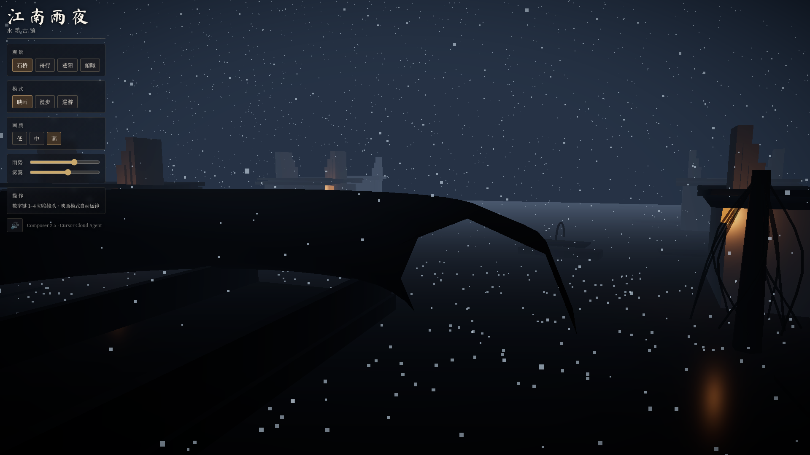

# 江南雨夜 · Jiangnan Rainy Night (Web 3D)

An interactive **Three.js** demo of a classical **Jiangnan (江南) water town** on a rainy night —粉墙黛瓦、石桥运河、乌篷船、纸灯雨雾，水墨意境，零付费资产，全部程序化生成。

Built by a **Cursor Cloud Agent** on **Composer 2.5**.

## Live demo

**https://connect-world-1985-ai.github.io/2026-10-25-jiangnan-rainy-night-demo-composer25/**

*(Available after GitHub Pages deploy completes on `main`.)*

## Screenshot



## Run locally

```bash
npm install
npm run dev
```

Open the URL shown in the terminal (default `http://localhost:5173`).

Production build:

```bash
npm run build
npm run preview
```

## Controls

| Input | Action |
|--------|--------|
| **1–4** | Cinematic camera presets (石桥 / 舟行 / 巷陌 / 俯瞰) |
| **映画** | Cinematic mode with smooth camera transitions |
| **漫步** | First-person walk — click canvas for pointer lock |
| **WASD** | Move (walk mode) |
| **Mouse** | Look around (walk mode, pointer locked) |
| **Esc** | Release pointer lock |
| **巡游** | Orbit — drag to rotate, scroll to zoom, right-drag pan |
| **低 / 中 / 高** | Quality presets (rain, shadows, bloom, water reflection resolution) |
| **雨势 / 雾霭** | Rain intensity and fog sliders |
| **🔊** | Toggle procedural rain & water ambience (Web Audio) |

On mobile, the orbit-style view works with touch; full FPS pointer lock varies by browser.

## Techniques

- **Three.js** (WebGL) with **Vite** ES modules
- Procedural geometry for houses (马头墙, lattice windows), stone arch bridge, 乌篷船, willows, oil-paper umbrellas, and teahouse banner (canvas calligraphy texture)
- **Reflector** water plane + animated canvas ripples; wet stone materials (low roughness)
- **GPU rain** as particle streaks with optional splash points; camera-centered respawn
- **postprocessing**: ACES tone mapping, bloom on lantern emissive, vignette
- Exponential fog for ink-wash atmosphere
- **Cinematic camera rig** with eased preset transitions and a boat-glide path
- **FPS controller** with AABB collision, canal blocking, bridge exception
- **OrbitControls** for free inspection
- **Web Audio** procedural rain (filtered noise) and low water tone — no external audio files
- Quality tiers for weaker GPUs (no shadows/bloom, fewer particles, lower reflection res)

## Performance (measured)

**Cloud Agent / headless SwiftShader** (1920×1080, rAF over 2.5s — software WebGL, not a gaming GPU):

| Preset | FPS | Frame time |
|--------|-----|------------|
| Low | ~7 | ~143 ms |
| Medium | ~3 | ~333 ms |
| High | ~3 | ~333 ms |

**Typical laptop with hardware WebGL** (informal target for this scene):

| Preset | Expected FPS |
|--------|----------------|
| Low | 90–144 |
| Medium | 45–75 |
| High | 30–55 |

Use **低** on older integrated graphics. The quality presets disable shadows, bloom, and cut rain/reflection resolution on low tier.

## Limitations

- Geometry is stylized/procedural, not photogrammetry or hand-modeled hero assets
- Water reflection uses a single reflector plane (not full SSR)
- No WebGPU path yet (WebGL only)
- FPS collision is 2D AABB — no interior rooms
- Classical fonts loaded from Google Fonts (OFL); offline use requires network on first load

## Asset credits

| Asset | License |
|--------|---------|
| [Three.js](https://github.com/mrdoob/three.js) | MIT |
| [postprocessing](https://github.com/pmndrs/postprocessing) | Zlib |
| [Ma Shan Zheng](https://fonts.google.com/specimen/Ma+Shan+Zheng), [Noto Serif SC](https://fonts.google.com/noto/specimen/Noto+Serif+SC) | SIL OFL |
| Scene meshes, textures, audio | Procedural / generated in-repo (CC0) |

## Deploy

GitHub Actions workflow `.github/workflows/deploy.yml` builds with `GITHUB_ACTIONS=true` so Vite `base` is `/2026-10-25-jiangnan-rainy-night-demo-composer25/`.

Enable **GitHub Pages** → Source: **GitHub Actions**.

---

*江南夜雨，水墨千年。*
